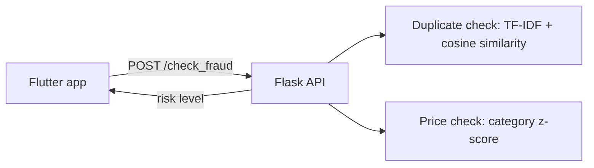

# PC Bazar

An Android marketplace app for buying and selling PC parts (GPUs, monitors, keyboards, mice), with an AI-based fraud check for new product listings. Final Year Project.

## What's inside
| Folder | What it is | Tech |
|---|---|---|
| [`pc_bazaar/`](pc_bazaar) | Android app | Flutter, Dart |
| [`ai_fraud_detection/`](ai_fraud_detection) | Fraud detection API | Python, Flask, scikit-learn |

## How it works
When a seller adds a product, the app sends the listing to the fraud detection API. The API returns a risk level (`safe`, `medium_risk` or `high_risk`) before the listing is accepted.



## Features
- Onboarding, sign up and login
- Categories: GPUs, monitors, keyboards, mice; search, featured items and favorites
- Cart and "Buy now" checkout with Cash on Delivery
- Add a product with image upload and an AI fraud check
- Admin screen to confirm or reject orders
- Notifications and profile (change password)

## Run it
**1. Fraud detection API**
```bash
cd ai_fraud_detection
pip install -r requirements.txt
python app.py
```

**2. Flutter app**
```bash
cd pc_bazaar
flutter pub get
flutter run
```
Demo login: `demo@pcbazaar.com` / `123456`

On the Android emulator, `localhost` points to the emulator itself. Use `http://10.0.2.2:5000/check_fraud` as the API URL (see [`pc_bazaar/README.md`](pc_bazaar/README.md)).

## Notes
- The app uses a local in-memory demo backend, so data is not saved after a restart.
- The fraud detection dataset is a small sample (6 products).
- Only the Android platform folder is included. To add iOS, web or desktop support, run `flutter create .` inside `pc_bazaar`.
